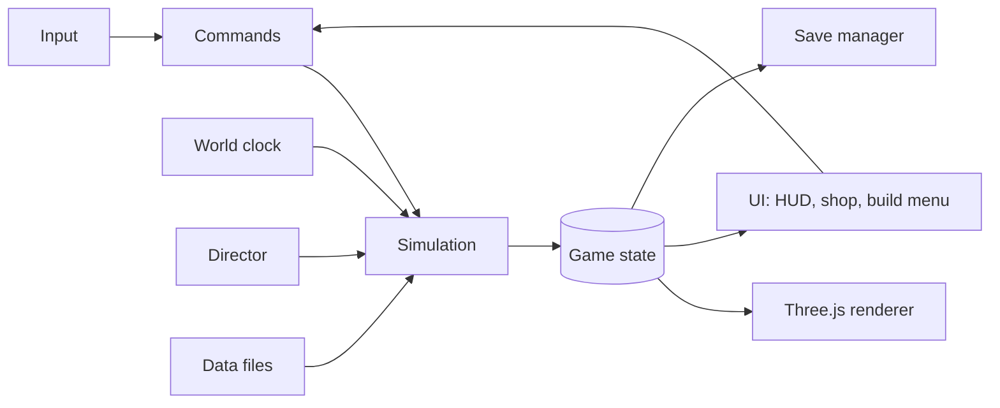

# Design Document

## Overview

A TypeScript browser game built with Vite and Three.js. Game logic (the simulation) is separate from rendering and UI. The simulation runs on a fixed 20 Hz step and exposes plain-data state. The renderer reads that state. The UI reads state and sends commands.

## Interaction model

The preparation phase is played from a city-management view, not through a walking character.

- The renderer exposes picking (`pick`), hover and selection highlights, camera pan/zoom, and map pins. It reports hover and click events through a small handler interface.
- `main.ts` turns a click into a place panel with a waypoint button. The player walks or drives: `updateMovement` runs once per frame in real time and changes `state.pos` (and the driven vehicle). `state.at` is worked out from `state.pos` by `sim/places.ts`, and the use key opens the shop at the door. The world outside the town is generated in chunks by `world/gen.ts` and drawn near the player by `render/streamer.ts`.
- Commands that change the game (`placeOrder`, `buyPlot`) live in `sim/` and check their own rules, including `state.at`, so the UI can never skip a rule.
- The UI is plain DOM: HUD, place panel, left drawer (storage, orders, news), and two modal views (shop, realty). Modals do not stop the clock. Views redraw only when their content changes, so a click is never lost to a rebuild.

## Architecture



### Folder layout

```
src/
  main.ts            entry, wires everything
  config.ts          reads env, validates, exports Config
  sim/               pure logic, no Three.js or DOM imports
    clock.ts         world clock
    state.ts         GameState types and factory
    commands.ts      player commands (buy, place, upgrade, eat, loot...)
    systems/         economy, delivery, construction, needs, farming, power,
                     zombies, waves, looting
    grid.ts          base grid, flow field
    rng.ts           seeded random
  render/            Three.js scene, camera, lighting, model loader, instancing
  ui/                HUD, menus (lightweight framework such as Preact)
  data/              items.ts, buildings.ts, locations.ts, zombies.ts, balance.ts
  save/              schema, migrations, local store (IndexedDB), cloud later
  director/          Director interface, RuleBasedDirector, GeminiDirector later
public/models/       glTF assets, CREDITS.md
.env                 VITE_TIME_SCALE=24
```

## World clock

Two time values exist:
- `realDt`: seconds of real play. Used for movement, combat, camera, and animation.
- `worldDt = realDt * TIME_SCALE`: used for the day cycle, needs, crop growth, construction, delivery timers, wave timers.

```
onFrame(now):
  if document.hidden or screen is Settings/SaveExit: lastNow = now; return
  realDt = min(now - lastNow, 0.25); lastNow = now
  accumulator += realDt
  while accumulator >= STEP (0.05):
    sim.step(STEP, STEP * TIME_SCALE)
    accumulator -= STEP
```

- On `visibilitychange` to visible, `lastNow` is reset so no catch-up happens.
- World time is stored as `worldSeconds` since Day 1 00:00 (starting at 8 h). Day number and time of day are derived.
- Because hidden tabs do not run, closing the tab is equivalent: the next session resumes from the saved `worldSeconds`.

## Key data models

```ts
interface GameState {
  version: number;
  worldSeconds: number;
  rngSeed: number;
  phase: 'prep' | 'outbreak' | 'dead';
  player: { pos: Vec2; health: number; hunger: number; thirst: number; fatigue: number;
            inventory: Inventory; backpackCapacity: number; vehicle?: VehicleState };
  money: number;
  stores: Record<StoreId, { stock: Record<ItemId, number> }>;
  orders: Order[];                  // { id, items, deliverAtWorldSeconds }
  plot?: { id: PlotId; bounds: Rect };
  base: { pieces: Piece[]; storage: Inventory; power: PowerState; water: WaterState };
  locations: Record<LocationId, { loot: LootState; lastLootedAt?: number }>;
  zombies: Zombie[];
  waves: WaveState;
  messages: Message[];
}

interface Piece {
  id: string; type: PieceType; cell: Vec2; rotation: 0 | 90 | 180 | 270;
  hp: number; maxHp: number; upgrades: UpgradeId[];
  buildProgress: number;            // 0..1, complete at 1
  extra?: unknown;                  // crops, fuel, etc.
}
```

Content (items, prices, building costs, durations in game seconds) lives in `data/`. Systems read from there.

## Systems

- **Economy:** stock per store, base price multiplied by a panic curve starting Day 20 (`price * (1 + k * panic(day))`, stock reduced by the same curve). Orders are stored with a delivery time and moved to base storage when the world clock passes it.
- **Construction:** a placed piece has `buildProgress` advanced by `worldDt / duration` while it is being built. Placement validity checks plot bounds, cell occupancy, and materials.
- **Needs:** per-world-second decay rates in `balance.ts`, modified by activity (running, building). Health loss when hunger or thirst is zero.
- **Farming and water:** crops hold a growth timer in world seconds. Water tank fills at a rate set by the plot's water access.
- **Power:** generator consumes fuel per world second while any powered piece is active. When fuel reaches zero powered pieces turn off.
- **Zombies:** each zombie has a state: wander, investigate (noise or light), chase, attack barrier. Movement uses `realDt`. Pathing uses a **flow field** computed by BFS over the base grid from the target (player or base core), with barrier cells costing more in proportion to their remaining HP. One field is shared by all zombies, so cost does not grow with zombie count. Spawn rate rises with day number and at night, capped at the config limit.
- **Waves:** a schedule produced by the Director (rule-based in this version), executed by the simulation.
- **Looting:** each location has loot containers with item tables. A search takes world time and produces noise. Depleted containers refill slowly over many days.

## Rendering

- Three.js scene with `OrthographicCamera` tilted about 45° and following the player, with limited zoom.
- Ground plane with texture. Models loaded as glTF (CC0 packs). Repeated pieces (fence, containers, trees) use `InstancedMesh`.
- One directional light with shadows plus ambient and hemisphere light. Sun angle and color follow world time. Lamps use cheap point lights, limited in number, or emissive materials with baked glow at distance.
- Upgrades are shown by swapping the model variant or adding attached meshes (spikes, barbed wire, boards).
- Damage is shown with tint or crack overlay by HP stage.
- A missing model falls back to a labeled box.

## Saving

- Serialize `GameState` to JSON with a `version` field. Stored in IndexedDB under a slot key, with a rolling backup of the previous good save.
- Triggers: every 60 s of active play, `visibilitychange` to hidden, `pagehide`/`beforeunload`.
- On load, run migrations from the stored version to the current one. If this fails, keep the backup and show an error.
- The cloud store (later) uses the same serialized format behind a `SaveStore` interface (`load`, `save`, `list`, `delete`).

## Director interface

```ts
interface Director {
  nextEvents(summary: WorldSummary): Promise<GameEvent[]>;
}
```

- `RuleBasedDirector`: produces news messages, panic steps, and wave schedules from day count and base strength.
- A later `GeminiDirector` will call a server-side function and return JSON. Events pass through a validator that checks the schema and clamps values, so a bad response cannot break the game, and failure falls back to the rule-based Director.

## Configuration

`.env`:
```
VITE_TIME_SCALE=24
```
`config.ts` parses it, falls back to 24 with a warning if invalid, and exposes balance values (starting money, zombie cap, autosave interval). Gemini keys are never placed in `VITE_` variables.

## Error handling

- Asset load failure: placeholder model plus a console and on-screen warning.
- Save failure (quota or blocked storage): show a visible warning and keep playing.
- Unknown save version: keep backup and offer New Game.
- Any exception in a system step is caught and logged so one bad system does not freeze the render loop.

## Verification approach

Each milestone has a "done when" check (see tasks) that can be verified by running the game. Simulation code has no browser dependencies, so automated tests can be added later if wanted.

## Decisions and trade-offs

| Decision | Why | Alternative |
|---|---|---|
| Sim separated from rendering | Saves, balance and AI work on plain data | Mixing logic into scene objects: faster at first, harder later |
| Fixed 20 Hz sim step | Predictable behavior, stable at any frame rate | Variable step: simpler, less stable |
| Flow field for zombies | Cost is constant per zombie | Per-zombie A*: heavy at 150 zombies |
| Scaled time only for the world | Movement stays playable at 24x | Scaling everything: unplayable |
| Local saves first | Fastest path to playable | Cloud first: adds auth and backend before gameplay exists |
